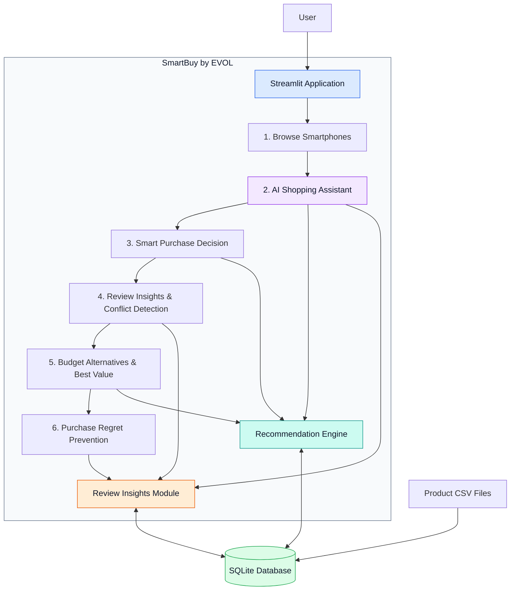

# SmartBuy by EVOL

SmartBuy by EVOL is an AI-powered smartphone shopping assistant built with Streamlit. It helps users explore smartphones, compare purchasing options, understand customer reviews and discover alternatives that match their budget and preferences.

## Features

- **Browse Smartphones** — Explore the available smartphone catalogue.
- **AI Shopping Assistant** — Ask shopping-related questions through a conversational interface.
- **Smart Purchase Decision** — Get product recommendations based on budget and preferences.
- **Review Insights & Conflict Detection** — Analyze customer feedback and identify conflicting observations.
- **Budget Alternatives & Best Value** — Discover alternatives and compare value within a budget.
- **Purchase Regret Prevention** — Consider potential drawbacks before making a purchase.

## Technology Stack

- Python
- Streamlit
- pandas
- SQLite
- Groq API
- python-dotenv

## Project Structure

```text
AI_Shopping_Assistant/
├── data/
│   ├── amazon.csv
│   └── smartphones_clean.csv
├── clean_data.py
├── evol_logo.png
├── preview_products.py
├── recommendation_engine.py
├── review_insights.py
├── setup_database.py
├── shopping_assistant.db
├── smartbuy_agent.py
├── smartbuy_banner.png
├── requirements.txt
├── .gitignore
└── README.md
```

## How It Works

1. Users interact with SmartBuy through the Streamlit application.
2. Product data is sourced from CSV files and stored in the SQLite database.
3. The recommendation engine supports product recommendations and value comparisons.
4. The review-insights module analyzes available customer feedback.
5. The AI shopping assistant handles shopping-related questions using the application's available functionality.

## High-Level AI Architecture



## Installation and Setup

### 1. Clone the Repository

```bash
git clone <REPOSITORY_URL>
cd AI_Shopping_Assistant
```

Replace `<REPOSITORY_URL>` with your GitHub repository URL.

### 2. Create a Virtual Environment

For Windows PowerShell:

```powershell
python -m venv .venv
.\.venv\Scripts\Activate.ps1
```

### 3. Install Dependencies

```bash
pip install -r requirements.txt
```

### 4. Configure the Groq API Key

Create a local `.env` file in the project root and add your API key using the environment-variable name expected by `smartbuy_agent.py`.

For example:

```env
GROQ_API_KEY=your_groq_api_key_here
```

Check your code for the exact variable name. Never commit your `.env` file or real API key to GitHub.

### 5. Set Up the Database

If the database needs to be created, inspect `setup_database.py` and run:

```bash
python setup_database.py
```

Before running the setup script against an existing database, check whether it overwrites or modifies existing data.

### 6. Run the Application

```bash
streamlit run preview_products.py
```

Open the local URL displayed in the terminal.

## Deployment

SmartBuy can be deployed using Streamlit Community Cloud. Connect the GitHub repository, select `preview_products.py` as the main file, configure the required secrets in the app settings, and deploy.

## Security Notes

- Never commit `.env` files, API keys, or other credentials.
- Keep virtual environments and Python cache files out of version control.
- Check the dataset terms before redistributing the data.
